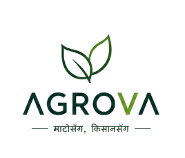
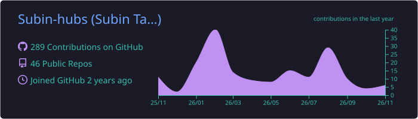
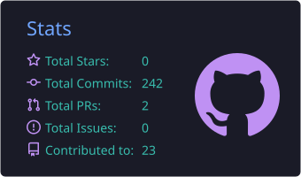
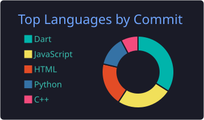

<!-- ═══════════════════════  HERO  ═══════════════════════ -->
<p align="center">
  
</p>

<p align="center">
  <a href="https://subintamang.com.np">
    
  </a>
</p>

<p align="center">
  <a href="https://subintamang.com.np"></a>
  <a href="https://linkedin.com/in/subin-tamang-394179300"></a>
  <a href="mailto:subintamang008@gmail.com"></a>
  <a href="https://github.com/subin-hubs"></a>
</p>


<!-- ═══════════════════════  ABOUT (as Dart code)  ═══════════════════════ -->
##  About Me

```dart
class SubinTamang extends Developer {
  final String role      = "Flutter & Full Stack Developer";
  final String location  = "Nepal 🇳🇵";
  final String portfolio = "subintamang.com.np";

  final List<String> building = ["Afforda — AI-powered personal finance app"];
  final List<String> learning = ["Riverpod", "AI Integration", "React", "Node.js", "System Design"];
  final List<String> askMeAbout = ["Flutter", "Dart", "Firebase", "UI/UX", "Git"];

  @override
  String get motto => "Clean architecture. Beautiful UI. Real impact.";

  bool openToCollab(String project) => project.contains("Flutter"); // 🤝 open-source welcome
}
```


<!-- ═══════════════════════  TECH STACK  ═══════════════════════ -->
##  Tech Arsenal

<p align="center">
  
  <br/><br/>
  
</p>


<!-- ═══════════════════════  FEATURED PROJECT  ═══════════════════════ -->
##  Featured Project

<table>
  <tr>
    <td width="55%" valign="middle">
      <h3>Aggrova</h3>
      <p>An <b>AI-powered agricultural application built with Flutter that helps farmers identify crop issues through intelligent crop scanning and analysis, access real-time weather updates, monitor live agricultural market prices, and manage their farming insights. Powered by Firebase for authentication and data storage, with Django backend services.</p>
      <p>
        
        
        
        
      </p>
      <a href="https://github.com/Subin-hubs/money_management"><b>➜ Explore the repo</b></a>
    </td>
    <td width="45%" align="center">
      <a href="https://github.com/Subin-hubs/AGROVA">
        
      </a>
    </td>
  </tr>
</table>


<!-- ═══════════════════════  STATS  ═══════════════════════ -->
##  GitHub Pulse

<!-- These cards are generated by .github/workflows/profile-cards.yml inside this repo -->
<p align="center">
  
</p>

<p align="center">
  
  
</p>

<p align="center">
  
</p>

<!-- Snake generated by .github/workflows/snake.yml -->
<p align="center">
  
</p>

<!-- ═══════════════════════  FOOTER  ═══════════════════════ -->
<p align="center">
  
</p>

<p align="center">
  
</p>
